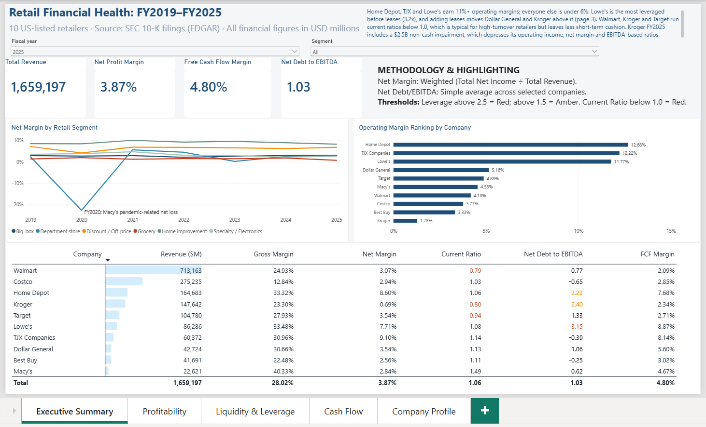
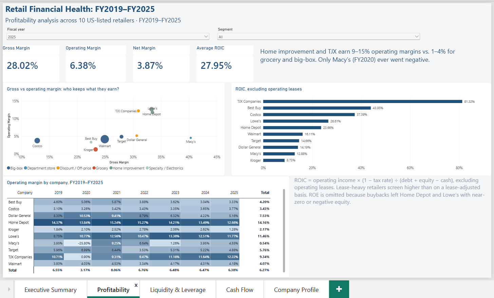
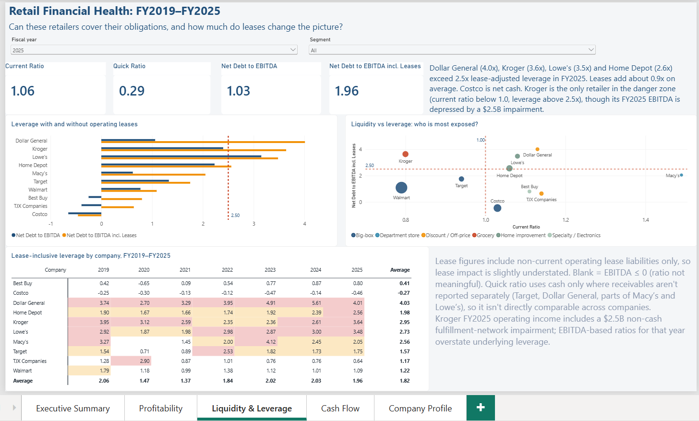
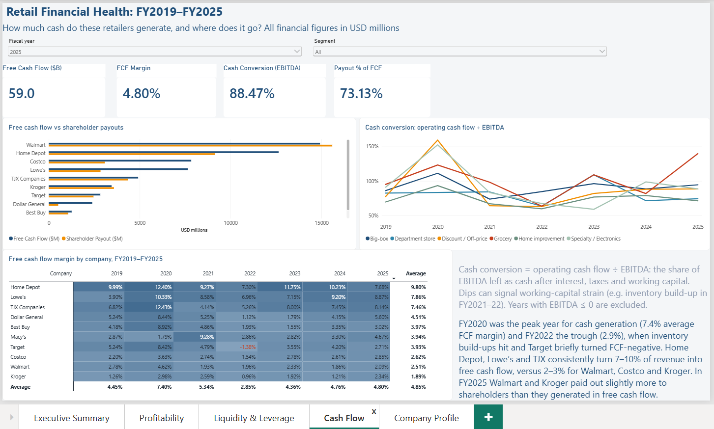
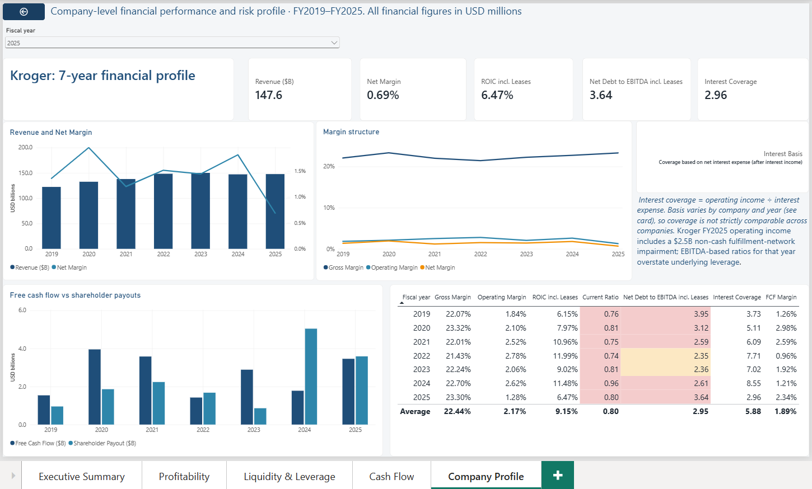

# Retail Financial Health Analysis: FY2019–FY2025

## Project Overview

This project analyses the financial health of 10 US-listed retailers over seven fiscal years using data extracted from SEC 10-K filings.

The objective is to compare profitability, liquidity, leverage, and cash generation across retail business models, identify financial risks, and understand how operating leases affect reported leverage.

The analysis combines Python data extraction, PostgreSQL data preparation and ratio analysis, independent Excel validation, and a five-page Power BI dashboard.

**Tools:** PostgreSQL · Python · Excel · Power BI

---

## Executive Summary

The analysis shows a clear separation in profitability and cash generation across the retailers. Home improvement retailers and TJX generally produce stronger operating and free cash flow margins, while grocery and big-box retailers tend to operate on thinner margins. Including operating lease liabilities materially changes the leverage comparison, and several retailers operate with current ratios below 1.0—an indicator of a relatively limited short-term liquidity cushion, but not necessarily distress in high-turnover retail models.

### Key Findings

#### 1. Profitability is concentrated among a few retailers

In FY2025, Home Depot (12.7%), TJX (12.2%), and Lowe's (11.8%) recorded operating margins above 11%. The remaining retailers were at 5.2% or below, down to Kroger at 1.3%. Net margins were also stronger for TJX (9.1%), Home Depot (8.6%), and Lowe's (7.7%) than for Walmart (3.1%) and Costco (2.9%).

#### 2. Stronger profitability generally translates into stronger free cash flow

Across FY2019–FY2025, Home Depot (9.8%), Lowe's (7.9%), and TJX (7.5%) averaged higher free cash flow margins than Costco (2.6%), Walmart (2.5%), and Kroger (1.9%). The group average peaked in FY2020 (7.4%) and reached its trough in FY2022 (2.9%), when Target's free cash flow margin turned negative (-1.4%).

#### 3. Operating leases materially affect leverage

Including operating lease liabilities increases the group's average net debt-to-EBITDA from 1.03x to 1.96x. Lease-inclusive FY2025 leverage highlights Dollar General (4.0x), Kroger (3.6x), Lowe's (3.5x), and Home Depot (2.6x) as retailers above the 2.5x analytical threshold. Costco is net cash. Dollar General's lease-inclusive leverage peaked at 5.6x in FY2024. Debt figures were checked against the balance-sheet presentation in the relevant 10-K filings, and scheduled maturities were not treated as current debt where no separate balance-sheet current portion was reported.

#### 4. Low current ratios need business-model context

Walmart (0.79), Kroger (0.80), and Target (0.94) have FY2025 current ratios below 1.0. In high-turnover retail, supplier credit and inventory turnover can support this operating model. The ratios still indicate a smaller short-term liquidity cushion and should be interpreted alongside leverage and cash generation rather than in isolation.

#### 5. The pandemic period hit department-store profitability particularly hard

Macy's recorded the only negative operating margin in the sample, reaching -25.8% in FY2020 before recovering to 9.3% in FY2021.

#### 6. Kroger FY2025 illustrates how one-off items can distort ratios

Kroger's net earnings fell from $2,665M to $1,016M. A $2,497M non-cash fulfillment-network impairment was recorded within operating profit, depressing operating margin and EBITDA-based ratios. Its FY2025 leverage therefore needs to be interpreted in light of the impairment. FY2024 shareholder repurchases were also affected by a $5B accelerated share repurchase.

---

## Business Recommendations

Based on the analysis, the following areas warrant further review:

- **Assess leverage alongside lease commitments:** Evaluate debt and operating lease obligations together when comparing retailers with different store-footprint strategies.
- **Monitor liquidity in context:** Use current and quick ratios alongside inventory turnover, operating cash flow, and supplier-credit characteristics rather than treating a sub-1.0 current ratio as an automatic distress signal.
- **Track free cash flow and shareholder payouts:** Compare dividends and buybacks with internally generated free cash flow to identify periods when distributions exceed cash generation.
- **Investigate unusual financial items:** Separate one-off impairments and other exceptional items from recurring operating performance when interpreting margins and leverage.
- **Compare retailers within relevant business models:** Differences in grocery, discount, department-store, home-improvement, and specialty retail economics mean that ratios should not be interpreted without industry context.

## Overall Conclusion

The analysis demonstrates that revenue scale alone does not determine financial health. Profit margins, cash conversion, liquidity, debt, and lease commitments provide different perspectives on a retailer's resilience and financial risk.

The strongest performers in this sample tend to combine higher operating profitability with stronger free cash flow generation. Lease-inclusive leverage and short-term liquidity measures, however, reveal risks that may not be obvious from profitability alone. The findings are descriptive of the selected retailers and period; they are not intended to represent the entire retail sector.

---

## Business Questions

The project was designed to answer:

1. Which retailers convert revenue into operating profit and free cash flow most effectively?
2. How did profitability and cash generation change across FY2019–FY2025, including COVID and the subsequent inventory and inflation cycle?
3. Which retailers carry the greatest leverage when operating leases are included?
4. Which retailers have tighter short-term liquidity, and how should that be interpreted in the context of their business models?
5. How do shareholder payouts compare with free cash flow generation?
6. How do company-level financial trends differ across the selected retail segments?

---

## Data and Scope

The project uses annual financial data extracted from SEC EDGAR company facts and annual 10-K filings.

| Item | Description |
|---|---|
| Companies | Walmart, Target, Costco, Home Depot, Lowe's, Kroger, Best Buy, Dollar General, TJX, and Macy's |
| Retail segments | Big-box, home improvement, grocery, specialty/electronics, discount/off-price, and department store |
| Reporting period | FY2019–FY2025 |
| Observations | 70 company-years |
| Source | SEC EDGAR XBRL company facts and annual 10-K filings |
| Currency convention | USD millions, unless otherwise indicated |

Annual data were extracted for 35 metrics per company. The extraction retains the XBRL tag and filing reference in the raw layer. Where values were restated, the latest filing was used.

---

## Dashboard Overview

The Power BI report contains five pages, with shared fiscal-year and segment filtering where applicable, conditional formatting for selected risk thresholds, and company-level drill-through.

| Page | Purpose |
|---|---|
| Executive Summary | Headline financial KPIs, net margin trends by segment, operating-margin ranking, and a company scorecard |
| Profitability | Gross vs. operating margins, ROIC comparison, and a seven-year operating-margin matrix |
| Liquidity & Leverage | Debt with and without leases, liquidity-versus-leverage comparison, and lease-inclusive leverage over time |
| Cash Flow | Free cash flow versus shareholder payouts, cash conversion, and FCF-margin trends |
| Company Profile | Drill-through seven-year financial profile for an individual retailer, including interest-coverage basis |

## Dashboard Preview

### 1. Executive Summary

Provides an overview of the financial performance of the selected retailers, bringing together headline KPIs, profitability trends, operating-margin comparisons, and a company scorecard to highlight differences across the retail group.



### 2. Profitability

Compares retailer profitability through gross margin, operating margin, net margin, and return on invested capital. The page helps identify which companies generate stronger returns and how profitability has evolved over the seven-year period.



### 3. Liquidity & Leverage

Examines short-term liquidity and debt exposure across the retailers, including the impact of operating lease liabilities on leverage. It highlights differences in financial risk that may not be apparent from profitability alone.



### 4. Cash Flow

Evaluates free cash flow generation, cash conversion, and shareholder payouts. The page compares retailers' ability to generate cash and highlights periods where cash generation weakened or payouts exceeded free cash flow.



### 5. Company Profile

Provides a drill-through view of an individual retailer's financial profile across seven years. Users can examine company-specific trends and metrics in greater detail, including the basis used for interest coverage.


---

## Interactive Power BI Report

The full interactive dashboard is available for download as a Power BI Desktop report.

**[Download the Interactive Power BI Report (.pbix)](powerbi/retail_financial_health.pbix)**

Download the file and open it in Power BI Desktop to explore all five report pages, interact with the fiscal-year and segment filters, and examine the financial metrics and company-level analysis.

The report is provided as a `.pbix` file for interactive exploration.

---

## Validation and Data Quality

### Independent SQL and Excel validation

Gross margin, operating margin, current ratio, free cash flow margin, net debt-to-EBITDA, and days inventory were independently rebuilt in Excel from exported tables and compared with SQL for all 70 company-years. The comparison produced **zero mismatches**.

### Selected checks against 10-K filings

Selected financial inputs were checked against original filings, including Target cash (FY2024), Best Buy cash and debt (FY2020), Macy's short- and long-term debt (FY2020), Kroger operating profit, net interest expense, earnings, dividends, and treasury-stock purchases (FY2024–FY2025), and Dollar General long-term obligations (FY2020–FY2022).

Corrections and classification decisions included:

- **Gross profit consistency:** Costco FY2019's reported GrossProfit tag excluded membership fees. A consistent gross-profit definition—revenue less cost of sales—was applied across companies.
- **Kroger interest:** FY2024–FY2025 interest coverage uses the net-interest line after the original tag changed. The cash-interest fallback had understated FY2024 coverage.
- **Dollar General debt:** Scheduled maturities due within one year were not treated as a separate current-debt balance-sheet line where no such line was reported. The FY2022 debt total was overstated by approximately $1.5B before correction.
- **Macy's debt:** FY2019 debt was corrected to avoid double-counting a scheduled maturity.

The SQL data-quality log in `sql/01_build_database.sql` (section 7d) documents derived, corrected, and flagged values.

---

## Methodology and Limitations

### Methodology

1. **Extract:** Python retrieves annual SEC company-fact data for selected metrics and uses the latest filing where values have been restated.
2. **Stage raw data:** Extracted facts are retained in PostgreSQL with their original XBRL tags and filing references.
3. **Clean and transform:** Data are pivoted and prepared into typed analytical tables, with documented rules and notes for derived or corrected values.
4. **Calculate ratios:** SQL calculates profitability, liquidity, leverage, working-capital, and cash-flow ratios, including leverage with and without operating leases.
5. **Validate:** Selected ratios are independently recalculated in Excel, and selected source inputs are checked against original 10-K filings.
6. **Visualize:** Power BI presents the analysis through a five-page dashboard, including company drill-through.

### Limitations and interpretive considerations

- **Interest coverage:** The calculation basis differs by company and year. Lowe's uses cash interest paid across all seven years, Dollar General in two years, and Kroger uses net interest expense for FY2024–FY2025. Coverage is displayed with its basis on the Company Profile page and is not directly comparable across all companies.
- **Quick ratio:** Receivables are not reported separately in approximately 20 of 70 company-years, mainly Target and Dollar General. Their quick ratio is cash-only and is not directly comparable with companies where receivables are separately available.
- **Operating leases:** Only non-current operating lease liabilities are included, so lease-inclusive leverage is slightly understated.
- **Fiscal calendars:** Costco's fiscal year ends approximately five months earlier than the January year-ends used by most other companies.
- **Gross margin conventions:** Costco's gross margin includes membership fees; Kroger's cost of sales excludes depreciation and amortization.
- **Negative EBITDA:** Company-years with negative EBITDA are excluded from leverage averages. ROE is blank where equity is zero or negative, including Home Depot and Lowe's.
- **Kroger FY2025 impairment:** EBITDA-based ratios are depressed by a non-cash impairment. FY2024 payouts also exclude a separately reported $1,000M unsettled accelerated share repurchase.
- **Analytical thresholds:** Leverage above 2.5x and 1.5x, and current ratio below 1.0, are rules of thumb used for highlighting—not universal standards.
- **Sample:** The project covers 10 selected US retailers; results describe this sample and should not be generalized to the entire retail sector.

---

## How to Run

1. Install the required Python package:
   ```bash
   pip install requests
   ```
2. Set your name and email in the `HEADERS` section of `python/pull_sec.py` to identify the SEC API request, then run the script to produce `sec_annual_facts.csv`.
3. Create a PostgreSQL database and execute sections 1–3 of `sql/01_build_database.sql`.
4. Load the generated CSV into `raw.sec_annual_facts`, then execute sections 4–7 of the SQL script.
5. Connect Power BI Desktop to PostgreSQL using `analytics.v_ratios` and `analytics.companies`, and create the relationship on `ticker`.
6. Review metric definitions, conventions, and documented rules in `docs/data_dictionary.md`.

---

## Repository Structure

```text
├── README.md
├── python/
│   └── pull_sec.py                     SEC data extraction
├── sql/
│   └── 01_build_database.sql           Schema, cleaning, corrections, ratios, checks
├── docs/
│   └── data_dictionary.md              Definitions and analytical conventions
├── powerbi/
│   └── retail_financial_health.pbix    Interactive Power BI report
└── screenshots/
    ├── 01_executive_summary.png
    ├── 02_profitability.png
    ├── 03_liquidity_leverage.png
    ├── 04_cash_flow.png
    └── 05_company_profile.png
```

---

## Skills Demonstrated

| Technical Skills | Analytical Skills |
|---|---|
| Python API extraction | Financial statement analysis |
| PostgreSQL schema design and constraints | Profitability and margin comparison |
| SQL views, CTEs, window functions, and aggregations | Liquidity and leverage risk assessment |
| Data-quality logging and correction documentation | Cash flow and payout analysis |
| Excel independent validation | Cross-company and multi-year analysis |
| Power BI data modeling and DAX | Interpretation of financial ratios and business models |
| Conditional formatting and drill-through | Communicating findings and limitations |

**Tools:** PostgreSQL · Python · Excel · Power BI · Git/GitHub

---

## Project Outcome

The project brings together SEC financial data extraction, documented data preparation, SQL-based ratio analysis, independent Excel checks, and an interactive Power BI dashboard. It demonstrates an end-to-end analytical workflow—from raw financial data through validation and interpretation—to compare retailer financial performance and identify areas of potential risk.
